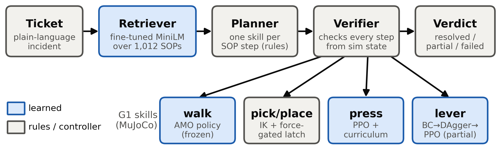

# Sequent

A simulated Unitree G1 humanoid that reads a plant-floor incident ticket, finds the matching procedure (SOP) out of 1,012, and carries it out in one continuous MuJoCo simulation. Every step is checked against the simulator state, so a step that fails is reported as failed.

<p align="center">
  
</p>

**[Project page](https://jatinsikka.github.io/sequent-g1/)** · **[Paper](docs/PAPER.md)** ([PDF](docs/paper.pdf)) · **[Retrieval reproduction](brain/benchmark/REPRO_REPORT.md)**

## How it works

1. **Retrieve.** A small transformer (MiniLM, 22.7M parameters), fine-tuned on operator-style tickets, picks the SOP that fits the ticket. It can only pick an existing procedure, never write a new one.
2. **Plan.** SOP steps are written as skills (`press_button estop_button`), so the plan is the SOP's steps in order. No learning here.
3. **Execute and verify.** The G1 walks (AMO policy), picks and places (IK with a force-gated latch), presses a button (PPO), and pulls a lever (BC + PPO). Each step has a precondition and postcondition computed from simulator state.

<p align="center">
  
</p>

## Results

**Retrieval**, 269 held-out tickets ranked against all 1,012 SOPs (fine-tuned: mean of 5 seeds):

| Method | R@1 | R@5 |
|---|---|---|
| TF-IDF | 0.30 | 0.54 |
| BM25 | 0.36 | 0.57 |
| MiniLM, not fine-tuned | 0.41 | 0.68 |
| **MiniLM, fine-tuned** | **0.58** | **0.86** |

- On SOPs never seen in training: 0.66 (untuned 0.47). On five machine families never seen: 0.61 (untuned 0.42).
- On clear tickets from someone who knows the system: 0.92, with the right SOP in the top 5 every time. Clear tickets are easy for every method; training matters on vague ones.
- Most mistakes pick the right problem on the wrong machine. The retriever always acts on its best guess; asking "which machine?" when unsure is the next step.

**Skills**, judged by the verifier:

| Skill | How | Result |
|---|---|---|
| Pick | IK + force-gated latch | 11 of 12 held lifts |
| Press | PPO + curriculum | 8 of 8 deterministic starts, 29–40 mm |
| Lever | BC → DAgger → PPO | 1 of 2 episodes (partial) |
| Full chain | walk, pick, carry, place, press | one take, every check passes |

RL grasping on this gripper-equipped humanoid reached 0% verified success (the logged "lifts" were the box popping out of the grip), which is why picking is a controller. The paper lists the six reward hacks we hit and how each was fixed.

## What's released

| Released | Not released |
|---|---|
| Retrieval benchmark, training, evaluation, and results (`brain/benchmark/`) | Press and lever RL checkpoints |
| Robot model sources, environments, rewards, training scripts | Compiled scenes (`*.mjb`); rebuild with `build_unified_model.py` (needs `mujoco_menagerie`) |
| AMO walking policy (`amo_jit.pt`) and the grasp v5.5 checkpoint | Training run logs |

Demo scripts check for the unreleased files and tell you which are missing.

## Quickstart

```bash
pip install -r requirements.txt        # Python 3.10

# Reproduce the retrieval results (CPU or Apple MPS; about 2 minutes per training run)
cd brain/benchmark
python -m src.retrieval.train_eval_sentence_encoder
python repro/repro_retrieval.py --split official --baselines --seeds 0 1 2 3 4
python brain_query.py "Hydraulic press ram is moving slower than usual" 5
cd ../..

# Ticket -> SOP -> plan
python -c "import brain_bridge as b; p, s, _ = b.incident_to_plan('Machine A pressure is low'); print(s['title']); print(p)"

# Robot demos (need the unreleased checkpoints)
python g6_onetake.py
python final_ticket_demo.py
```

For parallel RL training, set `OMP_NUM_THREADS=1` per worker; without it, throughput drops from about 2,600 to 18 steps/s.

## Repository

| Path | What |
|---|---|
| `brain/benchmark/` | 1,012-SOP corpus, retriever training and evaluation, results |
| `brain_bridge.py`, `brain/src/planner/` | Ticket → SOP → plan |
| `final_ticket_demo.py`, `g6_onetake.py` | The full-run demos |
| `verifier.py`, `executor.py` | Pre/postcondition checks |
| `ik_pick.py`, `pick_table.py` | Pick controller |
| `train_button.py`, `train_lever.py`, `train_lever_bc.py` | RL training |
| `unified_env.py`, `build_unified_model.py` | G1 with the Robotiq gripper |
| `docs/` | Paper, figures, project page |
| `experiments/` | One-off scripts from development |

## Credits

Jatin Sikka ([jatinsikka.me](https://jatinsikka.me)). The AMO whole-body controller is by Li, Cheng et al. (RSS 2025). Apache 2.0.
